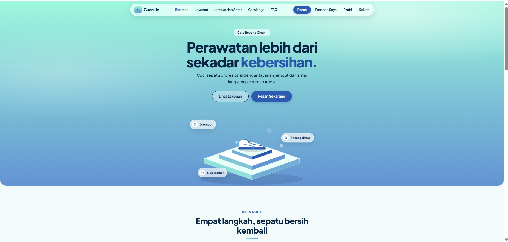
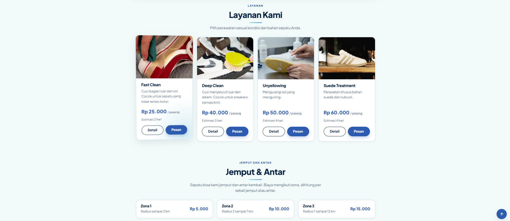
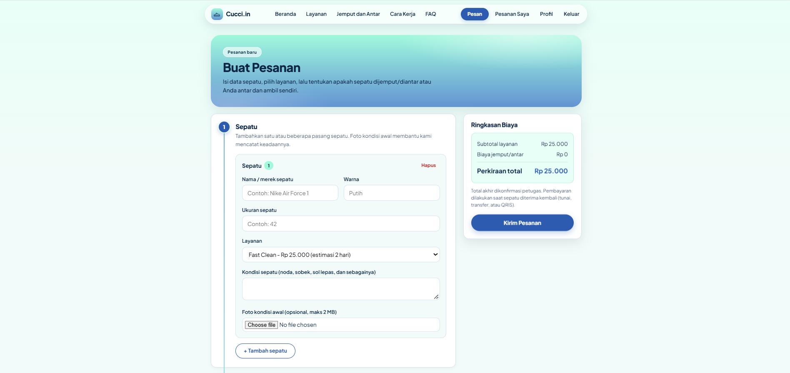
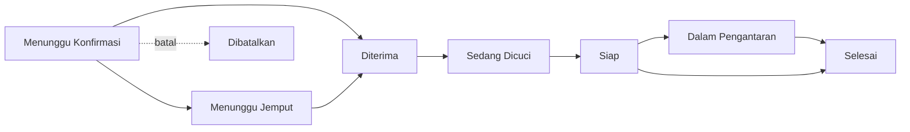

# 👟 Cuci Sepatu

**Sistem pemesanan jasa cuci sepatu dengan layanan jemput dan antar.**

Pelanggan memesan dari rumah dan memantau status tiap tahap. Petugas mengelola pesanan, penjemputan, pembayaran, dan layanan dari satu dashboard.


## 📸 Screenshot Aplikasi

### Beranda Pengguna


### Daftar Layanan


### Dashboard Petugas


---

## Latar Belakang

Proyek ini berawal dari dokumen *Identifikasi Proses Bisnis* sebuah usaha cuci sepatu. Masalah yang ditemukan dan solusi yang dibangun:

| Masalah di Proses Manual | Solusi di Aplikasi |
|---|---|
| Pertanyaan tentang layanan dan harga berulang | Beranda publik berisi layanan, harga, zona dan biaya, serta FAQ |
| Pencatatan pesanan manual | Pesanan tersimpan di database dengan kode otomatis `SC-yymmdd-001` |
| Tidak ada bukti kondisi sepatu | Foto kondisi sebelum dan sesudah pada setiap sepatu |
| Pelanggan tidak bisa cek status | Halaman status dengan bilah kemajuan dan riwayat tahap |
| Sulit mengabari saat selesai | Status "Siap" terlihat langsung dan tautan WhatsApp ke pelanggan |
| Verifikasi kepemilikan saat sepatu diambil | Kode pesanan yang ditempel di sepatu sebagai bukti ambil |

## Fitur

### Pengunjung
- Melihat layanan, harga, zona jemput/antar, dan FAQ tanpa login.

### Pengguna (Pelanggan)
- Daftar dan login, lalu pesan beberapa pasang sepatu sekaligus (nama, warna, ukuran, kondisi, foto awal).
- Jemput dan antar dapat dikombinasikan bebas, dengan biaya dihitung dari zona.
- Alamat tersimpan lebih dari satu (utama, Kantor/Rumah) dengan tautan dan pratinjau Google Maps.
- Memantau status, melihat riwayat, dan membatalkan pesanan selama belum diproses.
- Profil bergaya aplikasi modern: foto, bio, pengaturan akun, ganti akun/keluar.

### Petugas
- Mengelola pesanan dari konfirmasi sampai selesai, serta mencatat pembayaran (tunai/transfer/QRIS).
- Mengelola jemput dan antar, layanan, zona, dan data pengguna.
- Dashboard ringkasan pesanan dan omzet bulanan.

### Alur Status Pesanan



## Sorotan Teknis

- **Kontrol akses berbasis peran:** lewat middleware `role` dan enum `Role`. Data pengguna lain tidak bisa diakses (diuji otomatis).
- **Integritas harga:** harga dikunci saat pesanan dibuat, dan total selalu dihitung ulang di server (tidak percaya angka dari browser).
- **Transaksi database:** pada pembuatan pesanan, sehingga pesanan tidak pernah tersimpan setengah jadi.
- **Keamanan dasar:** validasi sisi server, perlindungan CSRF, pembatasan percobaan login (*throttle*), penghashan password, role akun baru dipaksa `pengguna`, dan validasi tautan agar hanya `http/https`.
- **Mesin status:** dengan enum `OrderStatus` (label, warna, aturan pembatalan) dan log perubahan status per pesanan.
- **Desain sistem tanpa framework CSS:** untuk sisi pelanggan: palet, token desain, animasi halus, hormat pada `prefers-reduced-motion`, dan aturan kontras teks. Sisi petugas memakai CoreUI.
- **Pengujian otomatis:** PHPUnit untuk alur pesanan, pemisahan akses, dan perhitungan total.
- **Tanpa langkah build:** CSS dan JavaScript ditulis langsung (tanpa Node/Vite), mudah dijalankan di Laragon atau hosting biasa.

## Teknologi

Laravel 13 · PHP 8.3+ · Blade · MySQL · PHPUnit · CoreUI 5 (sisi petugas) · JavaScript murni

## Menjalankan di Komputer Sendiri

### Prasyarat
- PHP 8.3+
- Composer
- MySQL (misalnya Laragon)

### Langkah Instalasi

```bash
git clone https://github.com/azkamawahieb-gif/Website-jasa-Cuci-Sepatu-berbasis-framework-laravel.git

cd Website-jasa-Cuci-Sepatu-berbasis-framework-laravel

composer install

cp .env.example .env

php artisan key:generate
```

Buat database bernama `cuci_sepatu` di MySQL, lalu sesuaikan konfigurasi `DB_*` pada file `.env`.

Lanjutkan dengan perintah:

```bash
php artisan migrate --seed

php artisan storage:link

php artisan serve
```

Aplikasi dapat diakses melalui:

`http://127.0.0.1:8000`

### Akun Uji

Akun berikut tersedia dari seeder (password: `password`).

| Peran | Email |
|---|---|
| Petugas | `petugas@cucisepatu.test` |
| Pengguna | `pengguna@cucisepatu.test` |

> Ganti password akun ini sebelum dipakai di server sungguhan.

## Pengujian

Jalankan perintah berikut:

```bash
php artisan test
```

Tes memakai SQLite memori sehingga tidak menyentuh database utama.

## Rencana Pengembangan

- [ ] Dashboard petugas dengan grafik dan animasi
- [ ] Notifikasi status pesanan dan pengaturan notifikasi
- [ ] Chat pengguna dengan petugas
- [ ] Laporan pendapatan dengan ekspor CSV
- [ ] Cetak label kode pesanan
- [ ] Deploy ke hosting

## Pembuat

**[Nama Anda]**  
Program Studi, Politeknik Caltex Riau

[LinkedIn / email]
